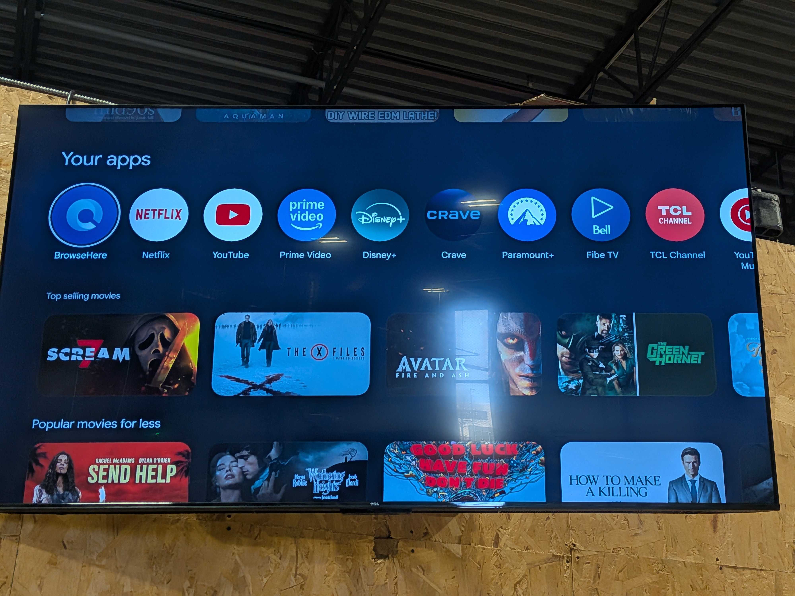
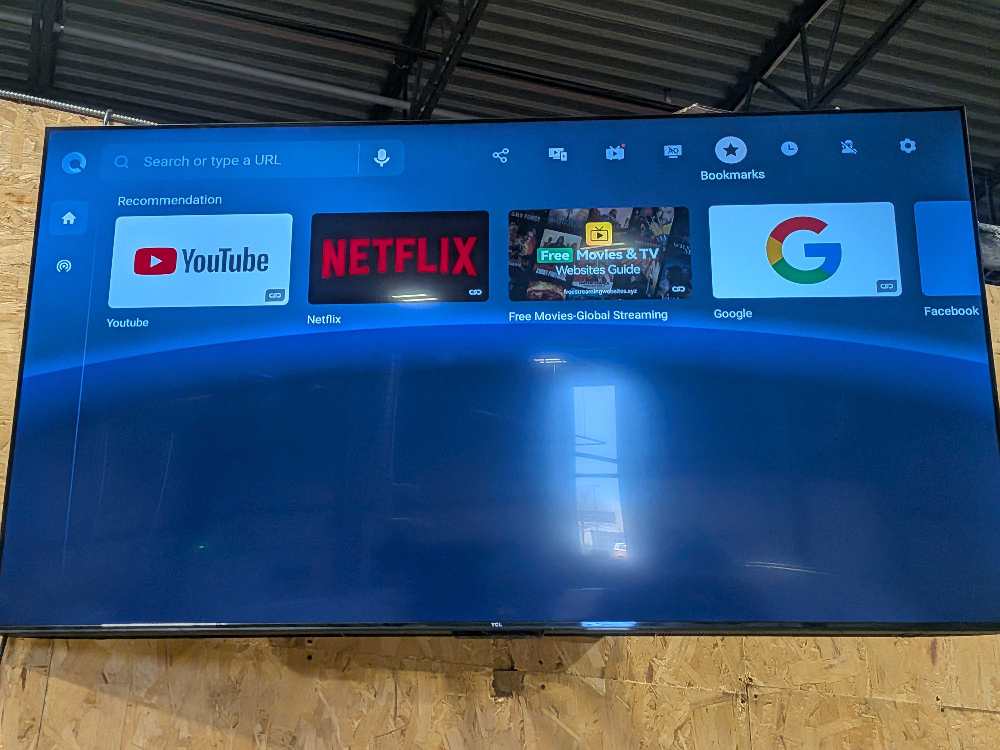
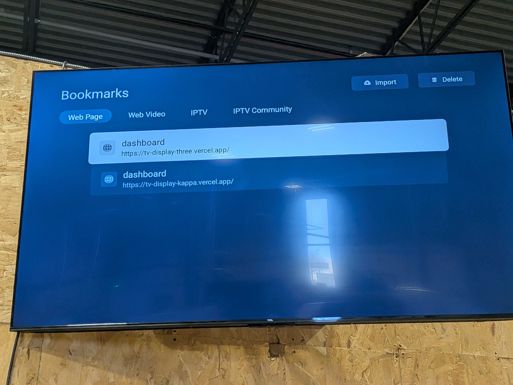

# How it works
The essential mechanic of this program is a webpage that runs on the TV.

## Opening the webpage
On the TV the following steps will get you to opening the webpage.

Step 1: Go to apps and open browser.

  

Step 2: Go to the bookmark tab on the browser

  

Step 3: Click on tv-display-three.vercel.app

  

## JSX
The webpage uses javascript mainly to run. Open weather app is used to get the temp & humidity while papaparse is used to sync the google sheets to the app. The tank values are fetched every minute while the weather is fetched every 10 minutes. For any modifications, refer to App.jsx. If you need to modify webpage layout, check out App.css as well.

## Vercel
The github page is linked with Vercel to deploy the webpage to the internet. The free version is used and has most of the features needed. The log in for Vercel is the engineering google account. The domain for this webpage is [tv-display-three.vercel.app](tv-display-three.vercel.app).

## Quote API
Quotes are fetched through the `/api/quote` Vercel function, which keeps the API Ninjas key on the server. Set `API_NINJAS_KEY` in the Vercel project's Environment Variables before deploying. For local development, add `API_NINJAS_KEY=your_api_key` to an ignored `.env.local` file in the project root, then restart the Vite dev server. Do not use a `VITE_` prefix; that would expose the key in the browser.

# React + Vite

This template provides a minimal setup to get React working in Vite with HMR and some ESLint rules.

Currently, two official plugins are available:

- [@vitejs/plugin-react](https://github.com/vitejs/vite-plugin-react/blob/main/packages/plugin-react) uses [Oxc](https://oxc.rs)
- [@vitejs/plugin-react-swc](https://github.com/vitejs/vite-plugin-react/blob/main/packages/plugin-react-swc) uses [SWC](https://swc.rs/)

## React Compiler

The React Compiler is not enabled on this template because of its impact on dev & build performances. To add it, see [this documentation](https://react.dev/learn/react-compiler/installation).

## Expanding the ESLint configuration

If you are developing a production application, we recommend using TypeScript with type-aware lint rules enabled. Check out the [TS template](https://github.com/vitejs/vite/tree/main/packages/create-vite/template-react-ts) for information on how to integrate TypeScript and [`typescript-eslint`](https://typescript-eslint.io) in your project.
